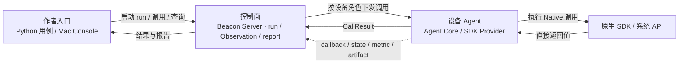

# Beacon 架构说明

Beacon 是面向 SDK 的自动化验证框架。测试流程写在 Python，用例通过设备角色控制一个或多个远端 Agent；Agent 在设备上调用原生 SDK，Server 管理运行并汇总调用结果与异步证据。

Beacon 的特色不止是用 Python 写测试。它还把多设备编排、多 SDK 接入和运行证据放进一条边界清晰的架构链路：

- **普通 Python 编排多设备**：一个 case 可以通过 `primary`、`peer` 等设备角色组织多个设备上下文。Server 将角色绑定到对应 Agent 和 lease；V1 用例按 Python 控制流顺序发起调用，Server 和 Agent 内部仍可使用异步 I/O。
- **多 SDK 共用接入机制，保留原生语义**：Agora、火山和 ZEGO 已接入 macOS。adapter 与编译后的 Registry 描述共享的 target、参数和观察合同；各 SDK 的 provider 保留原生对象模型、生命周期、回调语义和失败行为，不将不同厂商接口强行压成同一套 RTC API。
- **平台边界支持扩展，当前实现范围明确**：平台无关的 `agent_core/` 与承担连接、权限、线程及 SDK 集成的平台 Agent 分层。当前已落地的是 macOS Agent；iOS 和 Android Agent 尚未实现。
- **调用结果与运行证据闭环**：Native 方法的直接返回值与 callback、state、metric、log、artifact 等异步 Observation 分开记录。Python 用例可以等待并断言这些事实，Server 和 Console 使用同一 run 数据展示结果；音视频用例还可在 Console 查看本地/远端画面并采集视图快照。一次调用成功本身不代表媒体行为已验证，结论取决于用例实际采集和断言的证据。

## 一图看懂

图只保留运行期主链：Python 用例和 Console 都经 Server 操作 run；Server 按设备角色把调用发给 Agent；Agent 调用 Native SDK。SDK 直接返回值沿实线返回，callback、state、metric 和 artifact 等 Observation 沿虚线回到 Server。

这里把 Python 用例和 Mac Console 合并为“作者入口”，表示二者都通过 Server API 工作；前者执行用例和断言，后者负责启动 run、查看进度与结果。`sdk_adapters/` 到 Registry、再到 typed facade 的构建期关系不放进这张运行图，见下方“一个合同驱动生成与运行期校验”。

## 模块职责

| 模块 | 负责什么 |
|---|---|
| `test_cases/python/` | 普通 Python 测试用例、设备角色编排和断言；case catalog 提供可运行用例的静态元数据 |
| `python_sdk/beacon_test/` | `BeaconSession`、生成的 SDK typed facade、Observation 查询与用例 Runner 支持 |
| `server/` | Console/API 接口、设备和 lease 管理、run 与 Runner 生命周期、调用校验和分发、Observation 摄入与读取、报告和 artifact |
| `agent_core/` | 平台无关的协议模型、命令调度、callback 规则、资源和 reset 行为；不依赖具体平台 API 或厂商 SDK |
| `agents/` | 平台连接、权限与线程调度、Native provider、SDK callback/event bridge；平台细节留在对应 Agent |
| `sdk_adapters/`、`sdk_registry/compiled/` | SDK 能力与 target 的声明，以及编译后的 Registry 合同；供 facade 生成和 Server 校验使用 |
| `apps/mac_test_console/` | 用例和 SDK 导航、运行操作，以及 run、Observation 和报告的展示 |

Server 是设备和 run 的控制面：它把声明的设备角色解析到 Agent，并以 run、case、node 和 lease 限定操作范围。Python Runner 负责执行一个 case。Agent 是 Native 边界，持有平台 SDK 的实际调用、对象资源和线程规则。Console 使用 Server 提供的 catalog、run、Observation 与 report 数据，不直接连接设备 SDK。

## 一次调用如何执行

1. Console 或 API 根据 `case_ids` 创建 run。Server 选择设备、绑定角色和 lease，再启动独立的 Python Runner。
2. Runner 为当前 run/case 注入 `BeaconSession`。测试代码调用 typed facade 时，Python 会立刻发送一个带 run scope 的 HTTP 请求；该调用不是先记录下来、稍后再解释的步骤。
3. Server 校验 run/case、角色、lease 和 Registry 中声明的 target 与参数，再把至多一个 `invokeRequest` 经 WebSocket 发给绑定的 Agent。
4. Agent Core 将请求路由给已注册的 Native provider。Provider 按平台和 SDK 要求调度调用，并返回 Native API 的直接结果。
5. Server 把结果作为 `CallResult` 返回 Python。用例随后继续执行下一行；Server 仍负责 run/case 的终态、reset 编排和报告。

一个 facade 调用在 Server 到 Agent 的边界上至多对应一次 invoke。Native provider 为实现一个能力，可以在设备内组合多个 SDK 或系统 API；这些组合不会变成 Python 与多个远端命令之间的隐藏往返。跨设备流程则由测试作者按角色用普通 Python 排列。

## Observation 与断言

SDK 回调通常晚于调用返回，也可能与多次调用交错。因此 Beacon 把 Native 直接返回值与运行期观察分开保存：

- **调用结果**说明 Native 方法本身返回了什么。
- **Observation**记录结构化 callback/event、state、metric、log 或 artifact 等运行期事实。Agent 上报事实，Server 的 Observation Service 统一接收、校验、保存并提供 wait/query。
- **Python 断言**决定这些事实是否满足用例预期，之后 Server 汇总用例结果与报告。

例如，`join_channel` 返回成功并不单独证明 SDK 已发出“加入成功”回调，更不证明远端已经收到视频帧。用例应等待并断言相应 callback、state、metric 或媒体 artifact。Observation 查询可以按当前 run、case、role、node、lease 和 cursor 收窄范围；cursor 可用于取得较新的事实，但 Beacon 不据此推断 callback 是由哪一次 call 导致的。

## Callback 触发的 Native 后续操作

有些 SDK 要求在 callback 到达后及时执行另一个 SDK 或 Native 操作。测试用例可以预先把 role、callback target 和后续操作注册到 Agent。匹配的 callback 到达时，Agent 在设备侧执行这些操作，并随事件报告匹配和执行结果；测试进程不必先接到 callback，再跨进程往返下发命令。

注册成功只表示规则已经安装。用例仍要等待实际 callback，并检查规则是否命中及每项后续操作的结果。普通 callback Observation 也保持为独立事实，不会自动归因到某次 Python call。此能力是已声明 target 上的 Native 操作机制，不表示 Python callback 函数会在设备进程运行，也不表示所有原始音视频帧 Hook 都已实现。

## 设计亮点

### 普通 Python 控制流对应实际远端调用

facade 方法同步发送一次请求并等待 Native 直接返回。条件、循环、helper 和清理逻辑都留在熟悉的 Python 代码里；用例作者无需先学习调用录制、步骤 DSL 或第二阶段执行器。同步是作者接口的语义，Server 内部仍可使用异步 I/O。

### 一个合同驱动生成与运行期校验

`sdk_adapters/` 声明 target、参数和观察接口；编译后形成 `sdk_registry/compiled/` artifact。Python typed facade 根据这些描述提供作者入口，Server 使用 Registry 校验同一 target 和参数合同，也可用它识别当前平台未声明支持的调用。这样减少 facade、Server 和设备 provider 各自维护一份接口定义而产生的漂移。

### 共享传输机制，保留厂商语义

`agent_core/` 复用平台无关的协议和调度；Agora、火山、ZEGO 等 SDK 的 provider 保留自己的对象模型、方法含义、生命周期和失败语义。共同的是控制与证据机制，不是把不同厂商接口伪装成等价接口。

### 控制返回与异步证据相互独立

Native 方法返回、callback、state、metric、日志和 artifact 都能分别观察和断言。明确的事实边界避免把“命令已返回”“callback 已发生”和“媒体画面确实可见”混为一谈，也让 Console 和报告读取与测试断言来自同一 Observation 数据面。

### callback 后续动作在设备侧触发

对于已声明的 callback 与 target，Agent 可在 callback 到达时就执行后续 Native 操作。这缩短了触发到动作的控制路径，同时由 Agent 继续遵守平台线程和对象生命周期约束。规则安装与实际命中、执行结果分别可观察。

## 平台与验证边界

当前主要的真实 SDK Agent 位于 `agents/mac/`，仓库包含 Agora、火山和 ZEGO 的 macOS 接入。共享的 `agent_core/` 是跨平台边界设计，不代表 iOS 或 Android Agent 已经实现；真实操作系统级弱网注入也不属于当前已交付能力。

Mock 验证协议、Server 和通用控制链路；真实 SDK gate 才能验证指定设备与配置中的 Native 行为。是否证明了首帧、声音或画面，还取决于用例是否收集并断言对应证据。日志主要用于诊断，稳定可断言的条件优先建模为 callback、state、metric 或 artifact。

Server 默认以进程内存储为主，部分日志、run 或 artifact 索引支持 opt-in JSONL；这不等同于具备完整跨重启恢复或分布式持久化能力。

## 延伸阅读

- [Python 用例编写](python-test-authoring-guide.md)：了解作者入口、设备角色和断言方式。
- [SDK Adapter 接入](sdk-adapter-integration-guide.md)：了解如何声明 SDK 能力并接入 Native provider。
- [Mac Test Console](mac-console.md)：了解 Console 的运行与证据展示。
- [开发与验证](development.md)：了解构建、测试和结果语义。
